<p align="center">
  
</p>

<h1 align="center">Prabhjot Singh</h1>
<p align="center"><b>aka Thegreatprabh</b></p>

<p align="center">
  <a href="https://github.com/Thegreatprabh">
    
  </a>
</p>

<p align="center">
  <b>BBA FinTech & AI @ Chandigarh University — building clean tools, smart automations, and sharp digital products.</b>
</p>

<p align="center">
  <a href="https://github.com/Thegreatprabh?tab=followers">
    
  </a>
  
  
</p>

---

### ⚡ System Status

```txt
USER        Thegreatprabh (Prabhjot Singh)
BASE        Chandigarh University — BBA FinTech & AI
MODE        learning fast, building sharper, shipping better
STACK       Python | JavaScript | AI workflows | APIs | automation
MISSION     turn raw ideas into clean products people can actually use
SIGNAL      discipline > noise
```

### About Me

I'm Prabhjot — a BBA FinTech & AI student who'd rather **build** than just study. My thing is taking a rough idea, breaking it down, and shipping something real: tools, automations, dashboards, AI-assisted workflows.

I like things that feel simple on the outside and powerful under the hood. Every project is a rep — cleaner code, sharper systems, better products.

### 🧰 Current Loadout

<p>
  
</p>

### 🛠️ Battle-Tested Tools

| Tool | What it does |
| --- | --- |
| **Automation systems** | Turns repeated work into scripts, workflows, and connected tools. |
| **Dashboard builds** | Creates clean interfaces for tracking data, progress, and decisions. |
| **Full-stack experiments** | Builds practical web apps with useful flows, APIs, and real structure. |
| **AI-assisted workflows** | Uses AI as a force multiplier — faster builds, smarter systems. |
| **Launch polish** | Writes READMEs, setup flows, docs, and product pages that look serious. |

### 📡 GitHub Radar

<p align="center">
  
  
</p>

<p align="center">
  
</p>

### 🚀 Featured Arsenal

<p align="center">
  <a href="https://github.com/Thegreatprabh/phishguard">
    
  </a>
</p>

### 👾 Pac-Man Contributions

<p align="center">
  
</p>

### 🐍 Contribution Snake

<p align="center">
  <picture>
    <source media="(prefers-color-scheme: dark)" srcset="https://raw.githubusercontent.com/Thegreatprabh/Thegreatprabh/output/github-snake-dark.svg" />
    <source media="(prefers-color-scheme: light)" srcset="https://raw.githubusercontent.com/Thegreatprabh/Thegreatprabh/output/github-snake.svg" />
    
  </picture>
</p>

### 🤝 Connect

<p align="center">
  <a href="https://github.com/Thegreatprabh">
    
  </a>
  <a href="https://instagram.com/thegreatprabh">
    
  </a>
  <a href="mailto:thegreatprabh@gmail.com">
    
  </a>
</p>

<p align="center">
  <sub>Profile engineered for impact. Keep building. 🎯</sub>
</p>


